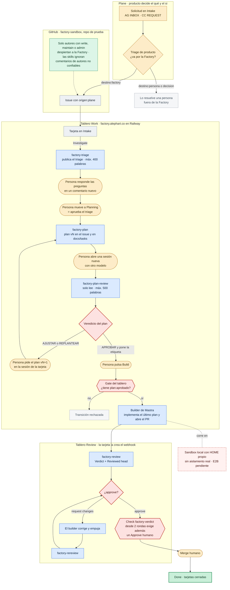
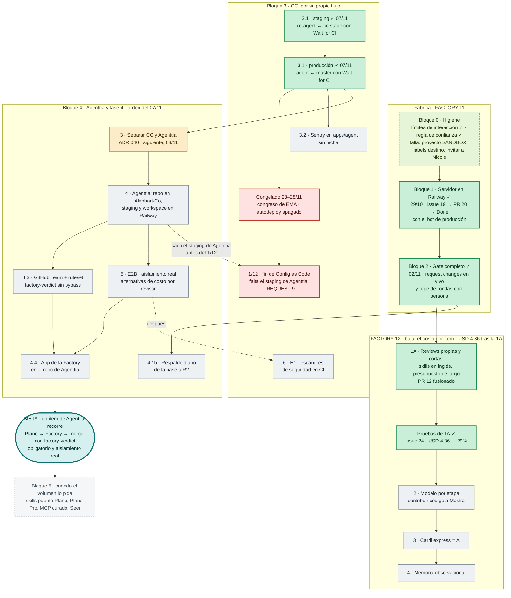
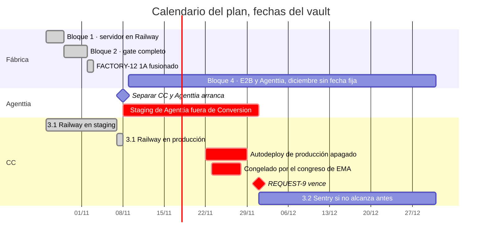
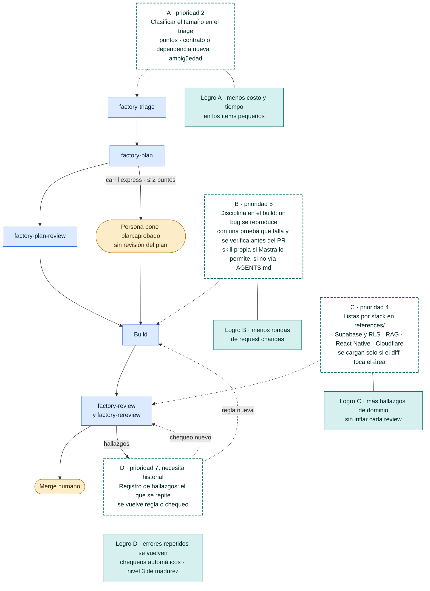
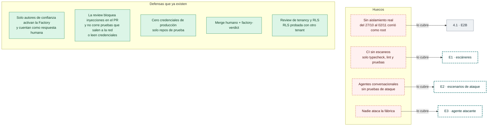
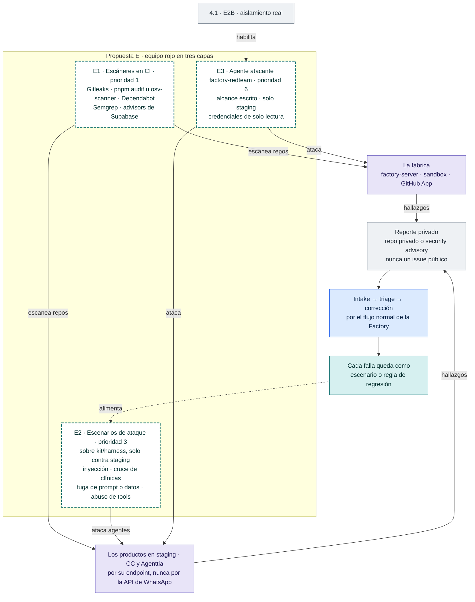
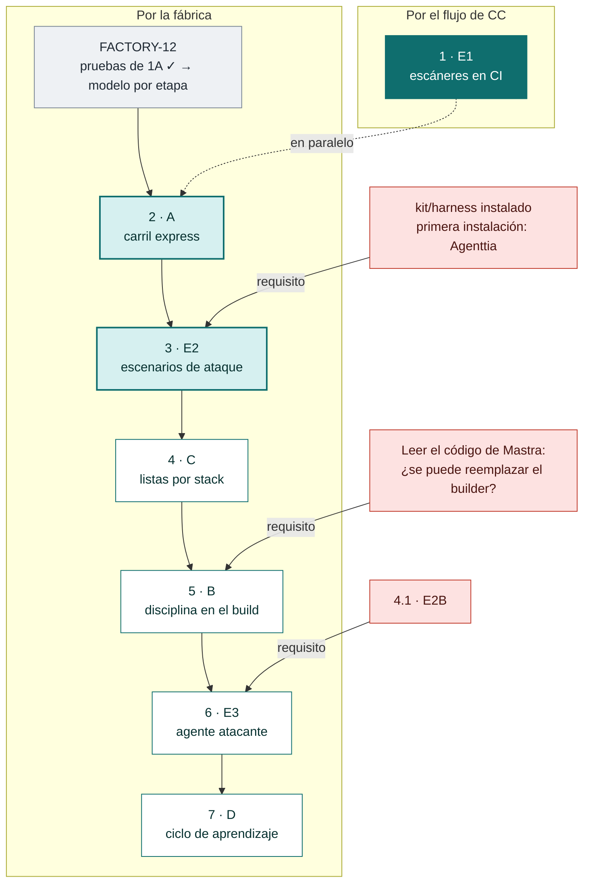

# Diagramas de la fábrica

Volver a [[README]] · Plan: [[plan-fabrica-2026-10-24]] · Costo: [[costo-por-item-2026-11-02]] · Estado: [[00-estado-actual]]

> **Versión visual (la que se usa para explicar):** lienzo de Claude Design «Software Factory · diagramas» —
> https://claude.ai/artifact/AwAuCkjgLVqRpcatthcU7j (01 Cómo funciona hoy · 02 Avance del plan · 03 A, B, C y D · 04 Seguridad y equipo rojo).
> Esta nota guarda las mismas ideas en Mermaid para leerlas dentro del vault. Estado al 07/11. El lienzo y esta nota no se sincronizan solos: al cambiar uno, actualizar el otro.

## 01 · Cómo funciona hoy

Un issue va de Plane al merge pasando por cinco skills propias. Ninguna etapa avanza sola: cada paso entre etapas lo da una persona, y el merge también.

*Flujo actual de Plane a Done en factory-sandbox, con las decisiones humanas y los gates de máquina.*

## 02 · Avance del plan hasta la meta

Los bloques 1 y 2, las pruebas de 1A y el 3.1 de CC están cerrados. Lo que sigue, en el orden del 07/11: separar CC y Agenttia, montar el repo y los entornos de Agenttia, la fase 4 (E2B) y E1. La meta es el primer ítem de Agenttia hecho por la Factory con aislamiento real.

> Estado revisado el 07/11 en el repo de CC, Railway y Plane.

*Bloques del plan del 24/10 con su estado y dependencias, hasta la meta de la fase 4.*

*Solo las fechas que están escritas en el vault. El bloque 4 no tiene fecha fija: el plan dice «Agenttia en diciembre».*

## 03 · Qué se logra con A, B, C y D

Las cuatro piezas que se toman de ECC se enchufan en etapas que ya existen; ninguna crea un pipeline paralelo. Cada una trae su logro y su prioridad en el orden acordado.

*Dónde entra cada pieza en el flujo y qué logra. B depende de si Mastra deja reemplazar el builder.*

## 04 · Seguridad: lo que hay, lo que falta y la propuesta

Las defensas actuales son pasivas. La propuesta E agrega un equipo rojo en tres capas, de la más barata a la más cara. Sus reportes entran por el Intake privado y cada falla encontrada se queda como prueba de regresión.

*Lo que ya protege a la fábrica y a los productos, y qué cubre cada hueco.*

*Las tres capas, qué atacan y cómo vuelve cada hallazgo al flujo. E3 solo arranca después de E2B.*

## 05 · Orden acordado

Orden de las piezas de ECC y del equipo rojo entre sí. En el orden general del 07/11, E1 va sexto: después de separar CC y Agenttia, montar Agenttia y E2B. En la fábrica, A llega después del modelo por etapa (las pruebas de 1A ya están). E2, B y E3 tienen requisitos que hay que cumplir antes.

*Los siete ítems en orden, con los requisitos que bloquean a E2, B y E3.*
